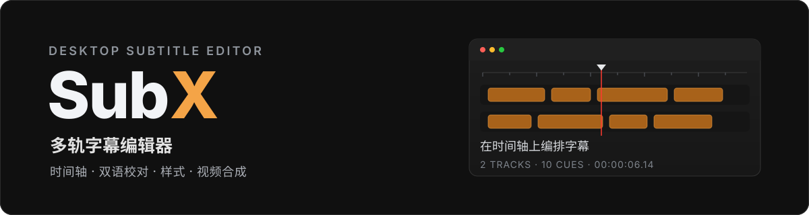
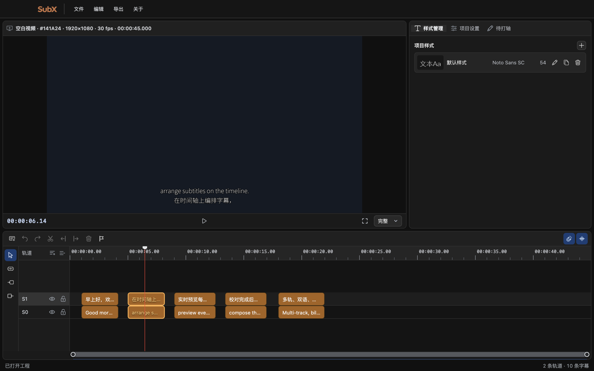

<p align="center">
  
</p>

<p align="center">
  
  
  
  
</p>

<h1 align="center">SubX</h1>

<p align="center">
  面向字幕工作的桌面编辑器：在一条多轨时间轴上编排 SRT / ASS 字幕，实时预览，校对双语，并直接合成带字幕的视频。
</p>

<p align="center">
  <strong>0.1.0-dev</strong> · 开发预览版，尚未发布正式版本 · <a href="docs/RELEASE-NOTES.md">发布说明</a>
</p>

<p align="center">
  
</p>

## 功能

- **多轨时间轴**：拖拽、裁剪、分割、框选、吸附、批量编辑，同一条轨道内的重叠字幕也能清楚区分。
- **SRT / ASS / WebVTT**：导入、编辑、导出；SSA v4 样式兼容；ASS 样式与内联标签尽量保持原样。
- **实时预览**：基于 libass 的字幕渲染，编辑样式时即时查看效果。
- **双语交付**：上下轨链接、合并双行导出、全部可见轨道批量导出与编码预设。
- **专业校对**：QC（CPS/时长/空行/重叠/标点）、系统英文拼写检查、已校对进度与待校对筛选。
- **时间码**：毫秒/非丢帧/丢帧显示；帧率转换功能已移除。
- **样式与字体**：项目内样式名称唯一，字体检查提示缺失字体。
- **视频合成**：把字幕烧录进视频，默认沿用源容器，可自定义码率、重编码或复制音频；HDR 可保留或转 SDR。
- **桌面体验**：macOS / Windows，深色界面，工程保存为 `.subx` 文件；自动保存与崩溃恢复。

## 快速开始

需要 Node.js 22.13 或更高版本。

```bash
git clone https://github.com/AchiDilyar/SubX.git
cd SubX
npm install
npm start
```

首次合成视频前，下载内置的 FFmpeg / FFprobe：

```bash
npm run fetch:ffmpeg
```

打包应用：

```bash
npm run package   # 输出到 out/
npm run make -- --platform=win32 --arch=x64   # Windows 安装程序
```

## 快捷键

- `Space`：播放 / 暂停
- `⌘N` / `⌘O` / `⌘S`：新建 / 打开 / 保存
- `⌘I` / `⌘E`：导入 / 导出字幕
- `⌘Z` / `⇧⌘Z`：撤销 / 重做
- `⌘A` / `⌘C` / `⌘V` / `Delete`：全选当前轨道 / 复制 / 粘贴 / 删除
- `←` / `→`，`Shift + ←` / `→`：移动 / 快速移动播放头
- `+` / `−`：缩放时间轴

完整列表见应用内「关于 → 快捷键一览」；Windows 上把 `⌘` 换成 `Ctrl`。

## 系统要求

- macOS：Apple Silicon
- Windows：x64（实机验收待完成）
- 源码开发：Node.js 22.13 或更高

## 反馈

遇到导入/导出错误、字幕错位或合成失败，请在 [GitHub Issues](https://github.com/AchiDilyar/SubX/issues) 附上工程文件、原始字幕和错误日志；Windows 实机问题请注明系统版本。

## 开发

```bash
npm test              # 单元测试
npm run test:desktop  # Electron 桌面回归
npm run release:check # 检查 out/ 下 macOS 发布包
npm run release:manifest # 生成发布文件 SHA-256 清单
```

## 说明

- 项目仍在快速迭代，接口和工程格式可能变化。
- 预览优先使用本机字体；缺少字体时回退到内置的 Noto Sans SC。
- 字幕渲染基于 [@jellyfin/libass-wasm](https://github.com/jellyfin/libass-wasm)。

## 致谢

Electron · libass · FFmpeg
